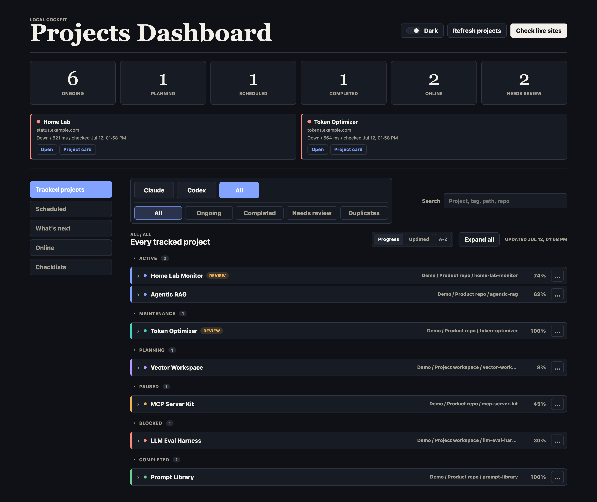
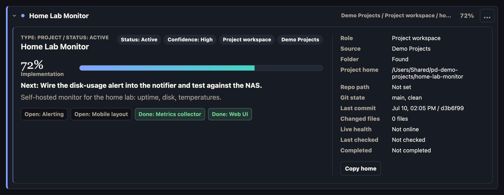

# Projects Dashboard

A local dashboard for tracking active projects, completed projects, local folders, repos, scheduled agent tasks, and online health.



Each project expands into a full card with progress, next action, milestones, and git evidence:



## Run

```bash
npm run dev
```

Then open:

```text
http://127.0.0.1:4173
```

The app has no third-party package dependencies. It uses Node's built-in HTTP server, Git CLI metadata, and a static frontend.

### First run

`data/` is machine-specific and gitignored, so a fresh clone starts empty: no projects, no suggestions, no scheduled tasks. That is expected. To populate the dashboard, create `data/dashboard.sources.json` (see Sync Projects below) and press **Refresh projects**, or run `npm run sync`.

## Layout

The page base, visible on every tab, is the metric strip (Ongoing, Planning, Scheduled, Completed, Online, Needs review) with the Online strip directly under it. Below that, a left rail switches between seven views:

- **Tracked projects**: the grouped project list (pinned, active, planning, paused, blocked, completed, private), with source and status filters, search, and sorting. Each row expands into the full project card. The row menu's **Move to** submenu moves a card to another status group by rewriting the `status` field in that project's own `.project-status.json` on disk (moving to Completed stamps `completedAt`, moving out clears it); its **Private** target changes no status files; the hidden list is saved server-side in `data/dashboard.prefs.json` (gitignored) so it holds across browsers and hostnames, while Pin stays browser-local. Group targets appear only on cards that have a status file.
- **Sessions**: Claude Code and Codex sessions running on this machine right now, one card each (see Running Sessions below). The rail tab carries a green count pill visible from every view, refreshed every 15 seconds.
- **Scheduled**: Codex automations and Claude Code scheduled tasks, with a Claude/Codex/All filter and per-task controls (see Scheduled Tasks below).
- **What's next**: idea rows from `data/next-projects.json`. These are suggestions, not tracked projects, and do not affect any counts. Each row has two actions: **Dismiss** hides the suggestion (its `status` flips to `dismissed` in the file; restore by editing the file), and **Start** promotes it, creating a new project home folder containing a planning `.project-status.json` and syncing it onto the Tracked board. Start writes a real folder on this machine, under `DASHBOARD_NEW_PROJECT_ROOT` if set, otherwise the first root in `data/dashboard.sources.json`.
- **Online**: one expandable row per project with a `liveUrl` or `healthCheckUrl`, showing the full latest health result.
- **Checklists**: two lists. **Projects Next Steps** is built from each card's `nextAction`; its check state is browser-local only and never edits the project's own files. Below it, a standalone checklist (currently the Knowledge Expanders learning list) is served from `data/checklist.json`; checking an item persists `done`/`doneAt` into that file via `POST /api/checklist/:id/check|uncheck`, so its state holds across browsers. The file is machine-specific and gitignored; if it is missing the group simply does not appear.
- **Waiting PRs**: open pull requests across every tracked project's GitHub remote, fetched via the `gh` CLI (must be installed and authenticated; non-GitHub remotes are skipped). Each card shows check status (Failed/Pending/Success/Draft), the review decision when there is one, branch, author, relative age, and a **Go to PR** link. The rail tab carries a red count pill visible from every view, refreshed every minute. `GET /api/waiting-prs` caches results server-side for a minute; a repo `gh` cannot reach becomes a note under the list instead of failing the view, and a missing `gh` binary just shows a hint.

## Sync Projects

The dashboard discovers projects from configured roots and merges them into:

```text
data/dashboard.config.json
```

Run a manual sync with:

```bash
npm run sync
```

Preview a sync without writing:

```bash
npm run sync:dry-run
```

The dashboard also runs sync before serving `/api/projects`, so normal page loads pick up status changes written by Claude or Codex. The open page quietly reloads project data while visible, reloads when the tab regains focus, and the **Refresh** button still runs sync explicitly before reloading project data.

Duplicate retained records that point at the same `statusFile` or `localPath` are collapsed during sync.

Next-project suggestions live in:

```text
data/next-projects.json
```

Configured source roots live in:

```text
data/dashboard.sources.json
```

This file is machine-specific and gitignored; without it no roots are scanned. Create it with the folders the dashboard should discover projects in:

```json
{
  "sources": [
    {
      "id": "projects-home",
      "label": "Projects",
      "type": "local",
      "rootPath": "/absolute/path/to/your/projects"
    }
  ]
}
```

## Running Sessions

The Sessions tab answers one question: which agent sessions are alive on this Mac right now. `GET /api/running-sessions` reads the process table (`ps`) and keeps the processes that are actually a Claude Code or Codex CLI:

- an executable named `claude` or `codex`, or a JS runtime handed a `claude`/`codex` script (the npm install shape, `node .../claude-code/cli.js`);
- anything inside a `.app` bundle is excluded, so the Claude desktop app and its Electron helpers never show up as sessions;
- a matched process whose parent also matched is a re-exec of the same session and is counted once.

Each session's working directory comes from `lsof` on macOS (`/proc` on Linux), which is what attributes a session to a tracked project: the deepest configured `localPath` containing that cwd wins, and a folder outside every source root is shown as **Untracked** rather than guessed at.

For Claude sessions the newest JSONL transcript under `~/.claude/projects/<encoded-cwd>/` (override with `CLAUDE_PROJECTS_DIR`) supplies the last activity time and the last prompt the person actually typed — tool results, slash-command plumbing, and meta entries are skipped. Two sessions open in the same folder share one transcript directory and nothing on disk says which file belongs to which pid, so both cards drop the prompt and say so instead of showing a guess. Codex writes no per-cwd transcripts, so its cards carry process facts only.

The view is read-only: it reports pid, tty, uptime, CPU, memory, and the command line, and never signals or kills anything. The scan is cached server-side for 5 seconds; the frontend polls every 15.

Sessions are the one thing on this board that cannot survive a restart of the machine, and the endpoint is as local as the rest of the API — see Security Model.

## Scheduled Tasks

The Scheduled tab reflects two runners:

- **Codex automations**, discovered from `$CODEX_HOME/automations/*/automation.toml` (default `~/.codex/automations`). Each automation becomes a card with its real name, status, recurrence rule, target workspace, model, and prompt.
- **Claude Code scheduled tasks**, discovered by scanning the Claude Code sessions directory for `scheduled-tasks.json` registries. The location defaults to the Claude app's sessions folder and can be overridden with `CLAUDE_SESSIONS_DIR`. A task whose id matches a tracked project attaches to that project's card; the rest get standalone cards.

Cards are read-only reflections of the runner's own state, except for three explicit controls:

- **Pause / Resume** edits the runner's own record: the `status` literal in the Codex automation TOML, or the `enabled` flag in the Claude task registry. Nothing else in those files is touched, and writes are atomic.
- **Run now** spawns a real agent process on this machine. Be aware of what that means before you press it:
  - a Codex automation runs via `codex exec` with the automation's own prompt, model, and working directory;
  - a Claude task runs via `claude -p` with the task's prompt, restricted to the `Read,Write,Edit,Glob,Grep,WebFetch,WebSearch,Skill` tools (no Bash, no MCP connectors);
  - the process is detached, capped at one concurrent run per task with a 30 minute timeout, and its log is written under `data/automation-runs/`;
  - neither app exposes an external trigger for the real schedule record, so dashboard-triggered runs do not appear in the apps' own histories.

## Enforcement (Optional)

The board stays truthful only if agents actually update `.project-status.json` when they
finish working. `hooks/status-stop-hook.mjs` is an optional Claude Code Stop hook that
makes this structural instead of conventional: a session that changed files inside a
tracked project is blocked from finishing until it updates that project's status file.
One nudge per stop, silent on sessions that touched no tracked project, fail-open on any
error, zero dependencies, zero model tokens except when a block lands. Install, split-layout
config, and the test suite (`node scripts/test-stop-hook.mjs`) are documented in
[docs/enforcement.md](docs/enforcement.md). Codex has no hook system; Codex sessions stay
on your standing instruction.

## Security Model

This dashboard has no built-in authentication and its API exposes local absolute paths, git remotes, notes, running agent command lines and prompts, and an endpoint that launches agent runs. It is designed to be reachable from this machine only:

- The server binds `127.0.0.1` by default and refuses to start on a non-loopback `HOST` unless `DASHBOARD_ALLOW_REMOTE=1` is set explicitly.
- Every request's `Host` header is checked against a fixed allowlist (a DNS-rebinding guard). A reverse proxy or tunnel hostname must be added via `DASHBOARD_ALLOWED_HOSTS` (comma-separated).
- Mutating requests are same-origin only; cross-origin writes are rejected against the same fixed allowlist, not the request's own headers.

If you want the dashboard reachable from anywhere, do not expose the port directly. Put an authenticating proxy in front of it (for example a Cloudflare Tunnel with Access, or a reverse proxy with SSO), keep the server itself on loopback, and add the public hostname to `DASHBOARD_ALLOWED_HOSTS`.

## Project Source Of Truth

`data/dashboard.config.json` is only the dashboard index. It is generated/merged from:

- discovered Claude/Codex project folders
- local git metadata
- each project's `.project-status.json`
- Codex automation files under `$CODEX_HOME/automations`
- Claude Code scheduled-task registries
- existing dashboard index entries that are outside the scanned roots

For real project status, add this file inside each project root:

```text
.project-status.json
```

Use specific names when one product has multiple homes. For example, use `Token Optimizer Product Repo` and `Token Optimizer Brain` instead of naming both folders `Token Optimizer`.

Moving a card between dashboard groups is controlled by the exact `status` value in that file. Use only `planning`, `active`, `blocked`, `paused`, `maintenance`, or `completed`.

Example:

```json
{
  "name": "Project name",
  "status": "active",
  "type": "codex",
  "repoUrl": "https://github.com/example/repo",
  "liveUrl": "https://example.com",
  "healthCheckUrl": "https://example.com/health",
  "progress": 65,
  "phase": "building",
  "confidence": "medium",
  "nextAction": "Verify the booking flow",
  "notes": "Short context for the project.",
  "completedAt": null,
  "updatedAt": "2026-07-01",
  "tags": ["dashboard", "local"],
  "milestones": [
    { "name": "Core UI", "done": true },
    { "name": "Live status checks", "done": false }
  ]
}
```

## Progress Model

Progress is intentionally hybrid:

- `progress` is a manual 0-100 estimate and should be treated as the source of truth.
- `milestones` explain the progress number.
- Git metadata and live checks are supporting evidence only.
- Do not infer fake progress from commit count, file count, or recent activity.
- Use `null` for unknown progress.
- Use `100` only when `status` is `completed`, `phase` is `shipped`, and `completedAt` is set.

Use these agent-writable status values:

- `planning`: not implemented yet, but intentionally tracked
- `active`: currently alive, under construction, or being actively considered
- `blocked`: waiting on something
- `paused`: intentionally not active
- `maintenance`: shipped but still alive
- `completed`: done and shown in completed projects

`scheduled` is a dashboard group derived from automation and task records; agents should not write `status: "scheduled"` in project status files.

Do not use natural-language aliases such as `done`, `working`, `testing`, `in progress`, or `on hold` in source files. The dashboard normalizes common aliases defensively:

- `done`, `finished`, `shipped` become `completed`
- `idea`, `backlog`, `planned` become `planning`
- `building`, `testing`, `implementing`, `coding`, `working`, `in progress`, `activated` become `active`
- `live` becomes `maintenance`
- `hold`, `on hold`, `deferred` become `paused`

If an agent writes an unrecognized status, the sync layer normalizes it to `active` and marks the generated dashboard record with `needs-review` and `status-normalized` tags. That prevents accidental new dashboard groups while still making the uncertainty visible.

Use these phase values:

- `idea`
- `planning`
- `building`
- `testing`
- `shipped`
- `maintenance`
- `paused`

Use these confidence values:

- `high`
- `medium`
- `low`

## Live Checks

Projects with `liveUrl` or `healthCheckUrl` can be checked from the local server. The UI reports:

- `Live`
- `Down`
- `Redirecting`
- `Auth required`
- `Unknown`

Live health is separate from project progress. A shipped site can be down, and an unfinished project can still have a live preview.

## Local Links

Browsers usually block direct opening of local folders from a webpage. The dashboard therefore shows copyable absolute paths. Repo and live links open normally when configured.
